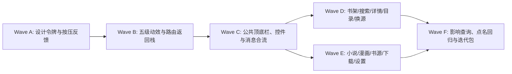

# Reader for HarmonyOS ·「墨纸青松 2.0」UI 统一重构工程实施方案

> [!IMPORTANT]
> 本方案直接面向 `Reader-for-HarmonyOS` 与 `Reader-UI` 正式工程代码落地，以已冻结的交互参考稿与当前工程边界为准，**不包含**对 `Reader-Core` 业务协议的推翻重写，也**不开放**尚未启用的功能模块。

---

## 1. 文档定位、权威输入与工程硬红线

### 1.1 权威输入与仓库基线

- **冻结交互参考稿**：[reader-harmonyos-ui-redesign.html](./reader-harmonyos-ui-redesign.html)（含 11 个完整页面、Phone/Tablet 双形态、日夜双主题、27 核心色彩角色、8 种阅读纸底、5 级动效实验室；已通过 `selectActiveBook` 与 `setAppTheme` 单源收口）。
- **设计令牌与契约仓**：`Reader-UI`（主色表源 [registry.json](../../theme/registry.json)，基准 `main@1985e6e`，颜色校验见 [check-theme.test.mjs](../../scripts/check-theme.test.mjs) 与 [validate.py](../../tools/validate.py)）。
- **HarmonyOS 工程仓**：`Reader-for-HarmonyOS`（基准 `main@ffe66a30`）。开工前先核对 `Reader-UI` 与 `Reader-for-HarmonyOS` 均处于干净工作树；若到时仍存在其他并行任务的未提交改动，必须原样保留，不得回退或覆盖无关文件。

### 1.2 五条工程硬红线（贯穿全部分期）

1. **Core / Host / UI 职责边界**（见 [ARCHITECTURE.md](../../../ARCHITECTURE.md)）
   - ArkUI 页面与 presentation 层只负责渲染状态和提交用户意图，**不得**建立第二份书籍、章节、进度、书源或下载事实源。
   - 书籍切换、加入/移出书架、进度提交、换源事务及删源操作均继续通过原 Core / Host owner 与 gateway 发起，回执以真实 ACK 为准，绝不把「点击动作」或「书架存在性」当成持久化完成。
2. **生成物单一维护源原则（严禁手改派生文件）**
   - [ReaderThemeRegistry.ts](../../../Reader-for-HarmonyOS/entry/src/main/ets/ui/foundation/ReaderThemeRegistry.ts)、[Reader-UI/theme/ReaderThemeRegistry.ts](../../theme/ReaderThemeRegistry.ts) 与 [ReaderThemeSelection.ts](../../../Reader-for-HarmonyOS/entry/src/main/ets/app/ReaderThemeSelection.ts) 均由 [generate-theme-registry.mjs](../../../Reader-for-HarmonyOS/tools/generate-theme-registry.mjs) 从 `Reader-UI/theme/registry.json` 自动生成并绑定 SHA256。
   - 深色 SVG 变体（`*_theme_night.svg`）由 [generate-theme-icons.mjs](../../../Reader-for-HarmonyOS/tools/generate-theme-icons.mjs) 与 `svg-provenance.config.mjs`、`tools/theme-svg-variants.json` 联动维护。
   - 部分视觉规格（如 [SharedDownloadVisualSpec.ts](../../../Reader-for-HarmonyOS/entry/src/main/ets/features/downloads/ui/SharedDownloadVisualSpec.ts) 及同类 `generate-*-visual.mjs` 产物）存在上游视觉生成/校验脚本，修改前需先运行影响查询，按其生成器合同同步更新或做经过审定的退旧迁移。
3. **单一状态发布源约束**
   - 应用日夜主题、小说纸底选择、漫画底色必须经 [ReaderThemeHost.ts](../../../Reader-for-HarmonyOS/entry/src/main/ets/app/ReaderThemeHost.ts) 统一协调与发布，页面不得直接写第二份 `AppStorage` 主题键或私自修改局部主题状态。
   - 各书独立阅读游标（章节索引、页码、百分比）只归属对应书籍实体/Core 读取会话；切换书籍时必须同步刷新阅读游标并隔离非当前书展示数据，严禁跨书串写进度。
4. **消息框架强约束**（见 [FRAMEWORK.md](../../../Reader-for-HarmonyOS/docs/message-ui/FRAMEWORK.md)）
   - 普通短反馈统一走 `ReaderTransientFeedback` → `ReaderTransientToast`（2000ms / 同宿主同 key 去重，退入后台或被覆盖页遮挡时显式停用 `feedbackEnabled`）；未确认原写入继续使用 `ReaderRecoveryNotice` / `ReaderRecoveryGroup` 独立悬浮恢复表面并保留原操作 `generation`。
   - 页面禁止直接调用系统 `showToast` / `showAlertDialog`；所有新增、调整的消息入口须同步更新 [message-entrypoints.json](../../../Reader-for-HarmonyOS/tools/message-entrypoints.json) 并通过 `node tools/check-message-entrypoints.mjs --check`。
5. **范围守卫**
   - 本次 UI 重构仅作用于现役开放产品面：**书架、全局搜索、书籍详情、完整目录、小说阅读器、漫画阅读器、换源浮层、书源管理与工具箱、下载管理、通用/书架设置及宽屏分栏壳、公共控件与弹窗/反馈**。
   - RSS、发现、同步及未开放设置继续保持既有关闭/保留边界，不得因 UI 重构开放未完成能力或改变现有功能开关。

### 1.3 Git 分支隔离与按 Wave 原子提交规范

- **专用特性分支**：开工前先核对 `Reader-UI` 与 `Reader-for-HarmonyOS` 均处于干净 `main`（或已完成仓库清理），然后在两仓各自从当前 `main` 切出同名特性分支（推荐 `feat/harmonyos-ui-redesign-20261124`）：
  ```sh
  git -C Reader-UI switch -c feat/harmonyos-ui-redesign-20261124
  git -C Reader-for-HarmonyOS switch -c feat/harmonyos-ui-redesign-20261124
  ```
- **严禁触碰区域**：禁止直接在 `main` 提交重构代码；禁止读取、修改、清理或丢弃 `.reader-isolated/`、`.worktrees/`、受保护归档分支（如 `archive/harmonyos-pre-phase1-main-20261123`）以及任何历史 `stash`；未经用户明确批准禁止执行 `git push` 或合回 `main`。
- **每 Wave 强制 1 个原子 commit**：每个 Wave（Wave A → Wave F）在通过本阶段影响查询与对应点名校验后，**必须先完成本 Wave 的独立 commit 并汇报 SHA**，再进入下一个 Wave；单次提交仅包含该 Wave 范围内文件，确保任意阶段可独立 `git revert` 与单独审阅 diff。
- **提交信息格式与跨仓 SHA 互引**：
  - 提交标题统一为 `feat(ui-redesign): Wave <A-F> - <本阶段简述>`，正文附带本阶段实测执行的校验命令与结论摘要。
  - 涉及双仓联动的 Wave（尤其是 **Wave A** 同时修改 `Reader-UI/theme/registry.json` 与 `Reader-for-HarmonyOS` 生成物）：**先提交 `Reader-UI`**，再在 `Reader-for-HarmonyOS` 对应 commit 正文中显式记录 `Reader-UI-Commit: <short-sha>` 及 `Registry-SHA256: <sha256>`，确保两仓版本严格一一对应。

---

## 2. 总体实施路线与分 Wave 里程碑



| Wave | 核心目标 | 主要涉及仓库/目录 | 退出判据 | 对应验证入口 |
| --- | --- | --- | --- | --- |
| **Wave A** | 上线「墨纸青松 2.0」27 语义角色、8 纸张与 8% 中性墨色按压反馈 | `Reader-UI/theme`、`ui/foundation`、`ui/surfaces` | `registry.json` 全量生成一致；控制岛/下载/TTS 不再分裂出孤立亮橙/蓝青主题；夜间图标对比达标 | `generate-theme-registry.mjs --check`、`generate-theme-icons.mjs --check`、`check-theme.test.mjs`、`validate.py --checks colors` |
| **Wave B** | 收敛五级动效时序；修复返回层级栈与转场方向语义 | `ui/foundation`（Motion）、`app/navigation`、`pages/Index.ets`、`BookshelfNavigationTransition.ets`、`ReaderSessionLaunchPresentation.ts` | Push 右→左 / Pop 左→右 / Tab 180ms 淡切清晰；深层多跳逐级退回；开书 `400/340ms`、胶囊 `380ms` 利索飞展同步起播、统一静纸柔墨克制曲线；减动效 120ms 轻淡入替代 0ms 硬切；仅手势/ Hero 飞跃保留帧驱动 | `gate-index-impact.mjs` 命中的 motion / navigation 相关精确 case |
| **Wave C** | 对齐公共顶栏/底栏、断点自适应、基础控件变体与消息视觉 | `ui/chrome`、`ui/patterns`、`ui/controls`、`ui/feedback` | `< 600vp` / `>= 600vp` 统一收口；Buttons/Toggle/Search/Select/Dialog/Toast 视觉一致且不破坏准入谓词与无障碍命中 | `check-message-entrypoints.mjs --check`、`check-header-geometry.mjs`（按需） |
| **Wave D** | 重构书架、搜索、详情、目录与换源浮层交互与布局 | `features/bookshelf`、`features/search`、`features/reading`（Detail/Directory）、`features/source`（Switch） | 作者与章节分行；详情换源/更多/6章滑窗；目录底栏跳转；换源活页底页轻模糊+分批增量重查不断焦点；多选按可见筛选限域 | `gate-index.mjs` 点名 bookshelf / search / directory / source-switch 相关 case |
| **Wave E** | 重构小说/漫画阅读、书源工具、下载管理与设置宽屏壳 | `features/reading`（Novel）、`features/manga`、`features/source`（Manage/Tools）、`features/downloads`、`features/settings` | 小说移除右上角常驻呼出钮并保留原版 24vp 轻陶纸播放胶囊（仅主色换松绿）；漫/小日夜底色经 `ReaderThemeHost` 双向联动；下载/书源筛选批操作限域；设置清缓存与完整恢复默认落地 | `gate-index.mjs` 点名 reading / manga / download / source / settings 相关 case |
| **Wave F** | 全链路变更影响扫描、精确门禁复核与迭代 HAP 构建 | 全部改动集合、`scripts/hap-pipeline.mjs` | 全部直接影响门禁点名 PASS；`hap-pipeline.mjs build --class iteration` 出包并核对 `minliny_HarmonyOS` / `io.reader.minliny`；未授权真机/VM 项诚实记 `NOT_RUN` | `gate-index-impact.mjs`、`ui-contract/cli.mjs`、`hap-pipeline.mjs build --class iteration` |

---

## 3. Wave A：设计令牌（墨纸青松 2.0）、排版与按压反馈

### 3.1 27 核心语义色表对照（严格对齐冻结稿）

| 分类 | 角色 Token（对应原稿 CSS Role） | 日间（Day · 宣纸） | 夜间（Night · 松墨） | 工程说明 |
| --- | --- | --- | --- | --- |
| **表面与画布 (6)** | `--rd-canvas`（页面纸底） | `#F4EFE6` | `#151715` | 替代全局应用页底（映射 `TOK_PAPER` / `TOK_SURFACE` / `app.window.background`） |
| | `--rd-surface`（卡片表面） | `#FBF8F2` | `#1F2320` | 嵌入式内容卡（映射 `TOK_CARD_BG` / `TOK_CARD_BG_HI`） |
| | `--rd-elevated`（浮层弹窗） | `#FFFDF9` | `#272C28` | Dialog / Sheet / Menu 实体表面 |
| | `--rd-sunken`（输入/凹槽） | `#EAE3D6` | `#191C19` | 输入框、分段槽、次级按钮底（映射 `TOK_FIELD_SURFACE` / `TOK_SURFACE_FIELD`） |
| | `--rd-glass`（半透浮层） | `rgba(253, 250, 244, 0.88)` | `rgba(34, 39, 35, 0.88)` | 常规玻璃模糊层（配合 `blur(20vp)`） |
| | `--rd-glass-heavy`（重模糊底盘） | `rgba(251, 248, 242, 0.94)` | `rgba(31, 35, 32, 0.94)` | 抽屉/阅读控制面板重模糊（配合 `blur(24vp)`） |
| **文字与线框 (7)** | `--rd-ink`（主文字墨） | `#1D1B18` | `#ECE8E0` | 主标题、正文列表标题（映射 `TOK_INK` / `app.text.heading`） |
| | `--rd-muted`（次级文字） | `#635D55` | `#A6A196` | 副标题、简介、次要说明（映射 `TOK_MUTED`） |
| | `--rd-subtle`（弱提示灰） | `#928B80` | `#747067` | 元信息、时间戳、占位提示（映射 `app.text.emptyHint` / `TOK_SS_MUTED`） |
| | `--rd-line`（常规分隔线） | `rgba(92, 79, 63, 0.10)` | `rgba(236, 232, 224, 0.09)` | 列表与卡片内分割线（映射 `TOK_LINE` / `TOK_ROW_DIVIDER`） |
| | `--rd-line-strong`（强调描边） | `rgba(92, 79, 63, 0.16)` | `rgba(236, 232, 224, 0.16)` | 悬浮边框、手柄、强描边（映射 `TOK_LINE_STRONG`） |
| | `--rd-press`（统一按压态） | `rgba(29, 27, 24, 0.08)` | `rgba(236, 232, 224, 0.10)` | 全应用统一中性按压叠加层，**淘汰旧 `TOK_ACCENT` 12% 亮橙叠加** |
| | `--rd-scrim`（模态遮罩） | `rgba(21, 23, 21, 0.38)` | `rgba(0, 0, 0, 0.58)` | 弹窗、底部 Sheet、全局搜索展开遮罩（映射 `app.scrim.*`） |
| **品牌与语义 (9)** | `--rd-primary`（品牌主色） | `#1F3D31` | `#7BB094` | 核心按钮、选中项、焦点胶囊（映射 `TOK_PRIMARY_DARK` / `TOK_GREEN`） |
| | `--rd-on-primary`（主色反白） | `#FAF7F0` | `#111B16` | 主色按钮/胶囊内文字与图标（映射 `TOK_ON_PRIMARY` / `app.control.onPrimary`） |
| | `--rd-primary-soft`（浅松绿底） | `rgba(31, 61, 49, 0.09)` | `rgba(123, 176, 148, 0.14)` | Tonal 按钮、高亮行、在读底色（映射 `TOK_PRIMARY_SOFT`） |
| | `--rd-primary-border`（选中描边） | `rgba(31, 61, 49, 0.28)` | `rgba(123, 176, 148, 0.34)` | 选中项/激活态边框（映射 `TOK_PRIMARY_BORDER`） |
| | `--rd-seal`（古铜点缀） | `#B86B2B` | `#D99452` | 印章点缀、书签高亮、阅读控制重点（替换旧 `#F48B13` 亮橙） |
| | `--rd-danger`（危险警示） | `#B83B32` | `#E0645A` | 删除、移除、失败状态（映射 `TOK_DANGER`） |
| | `--rd-on-danger`（危险反白） | `#FFFDF9` | `#FFFDF9` | 实心危险确认按钮文字 |
| | `--rd-success`（成功/缓存） | `#2E6F52` | `#6DC095` | 连通性正常、缓存完成（映射 `app.status.good`） |
| | `--rd-warning`（延迟/警告） | `#B87424` | `#E0A458` | 延迟偏高、超时预警（映射 `app.status.warning`） |
| **悬浮胶囊与控件 (5)** | `--rd-veil-bg`（薄雾顶栏底） | `rgba(255, 252, 248, 0.88)` | `rgba(48, 52, 45, 0.90)` | `AppTopBar` / 阅读悬浮顶栏薄雾背景（映射 `app.header.veilSurface`） |
| | `--rd-veil-border`（薄雾描边） | `rgba(198, 186, 164, 0.62)` | `rgba(108, 115, 100, 0.80)` | 悬浮顶栏边框（映射 `app.header.veilBorder`） |
| | `--rd-float-bg`（悬浮底栏实体） | `#FFFCF8` | `#36322E` | 底部 Tab 胶囊、详情底部操作岛、目录底部跳转条（映射 `app.navigation.floatingSurface`） |
| | `--rd-float-border`（悬浮底栏框） | `#D0C5B4` | `#62584B` | 悬浮底栏描边（映射 `app.navigation.floatingBorder`） |
| | `--rd-switch-thumb`（开关滑块） | `#FFFDF9` | `#F4EFE6` | 开关圆形滑块（映射 `app.toggle.thumb`） |

### 3.2 阅读控制岛 & 8 种阅读纸底收口

- **阅读控制岛（收口旧蓝青 `#2F6373` 与红陶分裂）**：将 `TOK_READ_*`、`TOK_TTS_*`、`TOK_DOWNLOAD_*` 等历史分裂角色在 `registry.json` 中统一对齐至「墨纸青松 2.0」陶纸 + 深松绿 + 古铜语义：
  - 日间控制岛：`ctrl-shell: rgba(255,250,244,0.96)`、`ctrl-card-solid: #FFFCF8`、`ctrl-primary: #1F3D31`、`ctrl-on-primary: #FAF7F0`、`ctrl-accent: #B86B2B`、`ctrl-ink: #332C25`、`ctrl-muted: #5B5046`、`ctrl-handle: #B9AD9F`。
  - 夜间控制岛：`ctrl-shell: rgba(33,38,34,0.96)`、`ctrl-card-solid: #272D28`、`ctrl-primary: #7BB094`、`ctrl-on-primary: #111B16`、`ctrl-accent: #D99452`、`ctrl-ink: #ECE8E0`、`ctrl-muted: #A6A196`、`ctrl-handle: rgba(236,232,224,0.28)`。
- **8 种阅读纸底（`registry.json -> reader`）**：

| ID | 名称 | Scheme | 色卡（Swatch / BG） | 正文墨（Ink） | 页眉页脚（Meta） |
| --- | --- | --- | --- | --- | --- |
| `day` | 日间 | `day` | `#FAF7F1` / `#F7F3EA` | `#2B241D` | `#766C61` |
| `warm` | 暖白 | `day` | `#F5E7CE` / `#F2E8D3` | `#2C241D` | `#766C61` |
| `paper` | 纸纹 | `day` | `#EAE0CA` / `#EDE2CB` | `#2B241D` | `#766C61` |
| `green` | 青叶 | `day` | `#DCE7D6` / `#E3EBDD` | `#263423` | `#63755F` |
| `night` | 夜间 | `night` | `#201F1C` / `#21221F` | `#E4DDD0` | `#9D968B` |
| `warmNight` | 暖夜 | `night` | `#2A231B` / `#31271D` | `#E7D8C8` | `#B3A18F` |
| `paperNight` | 夜纹 | `night` | `#22262E` / `#202630` | `#E2DDD5` | `#9BA5B2` |
| `greenNight` | 林夜 | `night` | `#1F2C22` / `#1D2D23` | `#D8E2D2` | `#97AA9A` |

### 3.3 改动文件清单与实施细则

1. [Reader-UI/theme/registry.json](../../theme/registry.json) → 运行 `node Reader-for-HarmonyOS/tools/generate-theme-registry.mjs` 重新生成 [ReaderThemeRegistry.ts](../../../Reader-for-HarmonyOS/entry/src/main/ets/ui/foundation/ReaderThemeRegistry.ts) 与 [Reader-UI/theme/ReaderThemeRegistry.ts](../../theme/ReaderThemeRegistry.ts)，并用 `check-theme.test.mjs` 校验 SHA256 与全量角色一致性。
2. [generate-theme-icons.mjs](../../../Reader-for-HarmonyOS/tools/generate-theme-icons.mjs) & `svg-provenance.config.mjs`：同步夜间 SVG 映射（确保原 `#2D4A3E` / `#2F6373` / `#1F3528` 在深色下映射为 `#7BB094` 等清晰对比色，避免暗底低对比）。
3. [ReaderPressFeedback.ets](../../../Reader-for-HarmonyOS/entry/src/main/ets/ui/foundation/ReaderPressFeedback.ets)：将 `composePressedSurface()` 从 `TOK_ACCENT`（`#F48B13` at `0.12`）改为中性墨色叠加（日间 `rgba(29,27,24,0.08)`，夜间 `rgba(236,232,224,0.10)`），补充微缩按压反馈 `scale: 0.978` 与 `140ms` 标准曲线，并保留失败回退原表面逻辑。
4. [ReaderTokens.ets](../../../Reader-for-HarmonyOS/entry/src/main/ets/ui/foundation/ReaderTokens.ets)、[ReaderTypography.ets](../../../Reader-for-HarmonyOS/entry/src/main/ets/ui/foundation/ReaderTypography.ets)、[ReaderSurfaceSpecs.ets](../../../Reader-for-HarmonyOS/entry/src/main/ets/ui/surfaces/ReaderSurfaceSpecs.ets)、[ReaderScrimColor.ets](../../../Reader-for-HarmonyOS/entry/src/main/ets/ui/surfaces/ReaderScrimColor.ets)：去除遗留高饱和橙/蓝青偏置与硬编码阴影色值；所有消费端通过 `readerAppColor(role, appThemeScheme)` 动态响应日夜切换，避免消费端持有静态 `TOK_*` 日间常量。

---

## 4. Wave B：五级动效收敛与分层路由/返回栈

### 4.1 校准后动效规格矩阵（对齐 `MOTION_SPEC`）

| 分级 | 交互场景 | 调整前（Legacy） | 调整后（Target） | 曲线 / 物理 | ArkUI 实现分层 |
| --- | --- | --- | --- | --- | --- |
| **M1 微交互** | 按钮/列表按压、Switch、Segmented 滑移、控制栏加书签、状态微动效 | 12% 亮橙突变叠加 | `140ms`（按压）/ `220ms`（底栏胶囊过冲 `≤1.05`）/ 定宽加签 `240ms` 自顶浸色与 `160ms` 去签收退；循环波形与呼吸点在后台/锁屏/遮挡/暂停即停 | `cubic(0.2, 0, 0, 1)` / 克制微扣 | `AttributeModifier` / `animateTo` |
| **M2 下拉折叠** | 书源分组下拉、书架筛选条、目录折叠 | 局部手写 VSync | 下拉 `160ms / 120ms`；筛选 `220ms / 180ms` | 展开 `cubic(0.16,1,0.3,1)` | ArkUI 原生 `animateTo` |
| **M2 浮层抽屉** | Toast、Popover、Modal、底部/右侧 Sheet | 漫画/换源/小说参数不一致 | Modal `220ms`、Toast `220ms`、Sheet 打开 **`260ms` / 关闭 `210ms`**（微阻尼无晃动，遮罩 `160ms`；换源列表禁逐行延迟飞入） | 统一克制弹簧 + `TransitionEffect` | ArkUI 原生合成器 |
| **M3 路由变形** | 一级 Tab、Push/Pop、搜索、书架切换 | 书架 `1000ms`、搜索 `650/700ms`、路由 0ms 硬切 | Tab `180ms`；Push `260ms`（底页微视差 `-16%` + 轻压暗 `4%`）/ Pop `240ms`（支持侧滑 `1:1` 中断）；搜索 **`260/240/200ms`**；书架重排 `320ms`（仅首屏前 6–9 本 `24ms` 错峰、封顶 `120ms`，视口外同步落位） | `cubic(0.2, 0, 0, 1)` | `Navigation` + `NavPathStack` + 共享悬浮顶栏 |
| **M4 物理连续** | 控制栏拖拽、翻页结算、封面 3D 开书、朗读胶囊、沉浸下拉书签、漫画章末上拉 | 开书 `780ms` 串行、胶囊 `3500ms`、书签 `16vp` 暗触发、漫画静态 `↑` | 控制栏 `220/200ms`（子面板左右横推 `240ms` / 总控纵抬 `220ms`）；封面并行开书 **`400ms` / 合书 `340ms`**；胶囊 **`380ms`** 利索飞展并 `t=0ms` 同步起播；纸顶丝带阻尼（`~86vp/46vp`）+ `280–300ms` 回位；漫画章末阻尼 + 矢量箭头 `160ms` 翻转 | 连续可逆时间轴 + 实测起点几何 | **仅此类**保留帧驱动（`FrameCallback`）+ 纯 TS 状态机 + 代际守卫 |
| **Reduce Motion** | 全局「减少动态效果」开启时 | 各处粗暴压为 `0ms` 闪烁硬切 | 统一 **`120ms` 轻淡入**（去除位移、缩放与封面/胶囊飞行） | `ease-out` | `ReaderMotionPolicy.ets` 单源分支 |

### 4.2 路由栈、转场方向与覆盖层策略

- **主导航与推栈分离**（[Index.ets](../../../Reader-for-HarmonyOS/entry/src/main/ets/pages/Index.ets)、[ReaderNavigation.ts](../../../Reader-for-HarmonyOS/entry/src/main/ets/app/navigation/ReaderNavigation.ts)、[ReaderMainTabs.ts](../../../Reader-for-HarmonyOS/entry/src/main/ets/app/navigation/ReaderMainTabs.ts)）：
  - **一级 Tab（书架 ↔ 设置）**：同级横向轻切换 `180ms` + 底栏胶囊 `220ms` 弹性滑移，切换时重置二级栈。
  - **二级及更深层级（Push / Pop）**：
    - 前进（`书架 → 搜索 → 详情 → 目录 → 阅读` 或 `设置 → 书源 → 工具箱`）：新页从右往左推入（`260ms`）。
    - 返回（逐级 `navBack` / 手势返回 / 独立预览页关闭 `isBack: true`）：当前页从左往右退出（`240ms`），弹出并恢复上一级页面滚动与筛选子状态，**严禁跳级直退回起点**。
    - 平板宽屏设置左栏切换（通用 / 书源 / 书架 / 下载）：保持左侧导航壳静止，仅右侧独立内容面板做 `180ms` 切换，同时清理无效子页临时返回栈（若处于外部子栈如阅读器进入的下载，则保留外部返回按钮）。
- **浮层覆盖原则**：
  - 换源（`SourceSwitchWindow`）、全局搜索遮罩、底部操作单与确认弹框全部渲染在当前活跃页面上层（叠加 `backdropBlur` 轻度模糊），**禁止替换底层画面**；关闭后无页面重载与转场抖动，仅在首开时播放 M2 浮层动效，弹窗内局部勾选重绘禁止重放进场动画。
- **改动文件**：
  - [MotionSpec.ets](../../../Reader-for-HarmonyOS/entry/src/main/ets/ui/foundation/MotionSpec.ets)
  - [ProductMotionTiming.ts](../../../Reader-for-HarmonyOS/entry/src/main/ets/ui/foundation/ProductMotionTiming.ts)
  - [ReaderMotionPolicy.ets](../../../Reader-for-HarmonyOS/entry/src/main/ets/ui/foundation/ReaderMotionPolicy.ets)
  - [ReaderMotionDurationPolicy.ts](../../../Reader-for-HarmonyOS/entry/src/main/ets/ui/foundation/ReaderMotionDurationPolicy.ts)
  - [BookshelfNavigationTransition.ets](../../../Reader-for-HarmonyOS/entry/src/main/ets/features/bookshelf/ui/BookshelfNavigationTransition.ets)
  - [ReaderSessionLaunchPresentation.ts](../../../Reader-for-HarmonyOS/entry/src/main/ets/features/reading/ui/ReaderSessionLaunchPresentation.ts)
  - [ReaderNavigation.ts](../../../Reader-for-HarmonyOS/entry/src/main/ets/app/navigation/ReaderNavigation.ts) & [Index.ets](../../../Reader-for-HarmonyOS/entry/src/main/ets/pages/Index.ets)

> [!CAUTION]
> 修改 `ReaderMotionPolicy.ets` / `ProductMotionTiming.ts` / `BookshelfNavigationTransition.ets` 前，务必先执行 `node tools/gate-index-impact.mjs --affected <路径>`；因为部分 `Phase 1` 已审用例绑定了控制栏展开与书架封面动画的精确认定参数，不得破坏已有帧驱动代际守卫。

### 4.3 全站设计语言统一基线（静纸柔墨 · Calm Paper & Ink）

- **色彩明确分工**：全站交互主色统一深松绿（日 `#1F3D31` / 夜 `#7BB094`）；古铜琥珀（`#B86B2B` / `#D99452`）严格收敛于**阅读进度、在读定位条与书签印记**；彻底清退旧蓝青（`#2379A4` / `#2F6373`）与高饱和亮橙按压（`#F48B13`）。
- **几何与图标同源**：悬浮顶底栏全胶囊化、内容载体为 `12–16vp` 陶纸圆角卡、抽屉固定 `24vp` 上圆角；全应用统一轻量圆头矢量线稿图标，**严禁混用裸 Unicode 字符箭头（如 `↓`、`↑`）或高饱和彩色 emoji 徽章**。
- **克制动效性格**：路由切换与面板展开坚持**无过冲精准停稳**（`cubic(0.2, 0, 0, 1)`）；底栏胶囊与书签丝带等微弹性过冲严格封顶 **`≤ 1.05`**，禁止社交 App 式大弹跳或扩散圆环光晕；**关闭一律快于打开 15–25%**（如 Sheet `260 / 210ms`、搜索 `260 / 200ms`、合书 `340 / 400ms`）；全局「减少动态效果」统一收口为 `120ms` 轻淡入。
- **视觉休眠与节能**：朗读微波形、自动翻页呼吸点与测速旋转动画仅在**活跃可见前台**运行；切后台、锁屏、被抽屉遮挡或处于暂停态时立即停止周期驱动。

---

## 5. Wave C：公共顶栏/底栏、控件矩阵与消息反馈合流

1. **自适应断点单一来源**（[ReaderWidthClass.ts](../../../Reader-for-HarmonyOS/entry/src/main/ets/ui/foundation/ReaderWidthClass.ts)）
   - 保持 `compact < 600vp`（Phone）/ `expanded >= 600vp`（Tablet/折叠屏展开）单一判断函数，页面禁止自写另一套宽度阈值。
2. **顶栏与底栏标准化**
   - [AppTopBar.ets](../../../Reader-for-HarmonyOS/entry/src/main/ets/ui/chrome/AppTopBar.ets)、[PageBackBar.ets](../../../Reader-for-HarmonyOS/entry/src/main/ets/ui/chrome/PageBackBar.ets)、[ReaderReadingTopBar.ets](../../../Reader-for-HarmonyOS/entry/src/main/ets/ui/chrome/ReaderReadingTopBar.ets)：统一薄雾胶囊样式（`app.header.veilSurface` + 边框 + Blur `10–14vp`）、返回按钮（左箭头返回上一级）、主副标题两行截断与右侧紧凑操作区。
   - [ReaderBottomTabBar.ets](../../../Reader-for-HarmonyOS/entry/src/main/ets/ui/patterns/ReaderBottomTabBar.ets)：底部悬浮圆角胶囊（`app.navigation.floatingSurface` + 边框），内嵌主色高亮激活胶囊，窄屏底部通栏居中、宽屏最大宽度悬浮居中。
   - [NoCoverCover.ets](../../../Reader-for-HarmonyOS/entry/src/main/ets/ui/patterns/NoCoverCover.ets)：对齐宣纸无封面风格（装订线、双框线、`seal` 印章角落标记、宋体书名居中截断、底部 `无封面 · 类型` 标签）。
3. **统一控件家族**（`ui/controls/*` & `ui/surfaces/*`）
   - [ReaderButton.ets](../../../Reader-for-HarmonyOS/entry/src/main/ets/ui/controls/ReaderButton.ets)：统一 4 变体（Primary / Tonal / Subtle / Danger）× 3 尺寸（46vp / 38vp / 30vp）及禁用态，统一接入新按压态 `ReaderPressFeedback`。
   - [ReaderSearchField.ets](../../../Reader-for-HarmonyOS/entry/src/main/ets/ui/controls/ReaderSearchField.ets)、[ReaderToggle.ets](../../../Reader-for-HarmonyOS/entry/src/main/ets/ui/controls/ReaderToggle.ets)、[ReaderSelect.ets](../../../Reader-for-HarmonyOS/entry/src/main/ets/ui/controls/ReaderSelect.ets)、[ReaderSegmentedControl.ets](../../../Reader-for-HarmonyOS/entry/src/main/ets/ui/controls/ReaderSegmentedControl.ets)、[StatusBadge.ets](../../../Reader-for-HarmonyOS/entry/src/main/ets/ui/controls/StatusBadge.ets)：统一高度、圆角（全胶囊输入条与标签、24vp 上圆角底部抽屉、22vp 居中弹框）、Tabular 数字对齐。
   - [ReaderDialogSurface.ets](../../../Reader-for-HarmonyOS/entry/src/main/ets/ui/surfaces/ReaderDialogSurface.ets)、[ReaderActionMenuSurface.ets](../../../Reader-for-HarmonyOS/entry/src/main/ets/ui/surfaces/ReaderActionMenuSurface.ets)、[ReaderCard.ets](../../../Reader-for-HarmonyOS/entry/src/main/ets/ui/surfaces/ReaderCard.ets)：统一描边、背景角色与阴影层级。
4. **消息与恢复组件**（`ui/feedback/*`）
   - [ReaderTransientToast.ets](../../../Reader-for-HarmonyOS/entry/src/main/ets/ui/feedback/ReaderTransientToast.ets)、[ReaderRecoveryNotice.ets](../../../Reader-for-HarmonyOS/entry/src/main/ets/ui/feedback/ReaderRecoveryNotice.ets)、[ReaderRecoveryGroup.ets](../../../Reader-for-HarmonyOS/entry/src/main/ets/ui/feedback/ReaderRecoveryGroup.ets)、[ReaderPageState.ets](../../../Reader-for-HarmonyOS/entry/src/main/ets/ui/feedback/ReaderPageState.ets)：仅做配色、字体与圆角同步至「墨纸青松 2.0」，**完整保留** `FRAMEWORK.md` 的准入谓词、`actionGeneration`、有界滚动与 `HitTestMode` 规则；变更后核对 [check-message-entrypoints.mjs](../../../Reader-for-HarmonyOS/tools/check-message-entrypoints.mjs)。

---

## 6. Wave D：核心浏览与选书链路改造（书架 / 搜索 / 详情 / 目录 / 换源）

### 6.1 书架（Bookshelf）
- **涉及文件**：[BookshelfPage.ets](../../../Reader-for-HarmonyOS/entry/src/main/ets/features/bookshelf/ui/BookshelfPage.ets)、[BookshelfScene.ets](../../../Reader-for-HarmonyOS/entry/src/main/ets/features/bookshelf/ui/BookshelfScene.ets)、[ShelfBookListDetails.ets](../../../Reader-for-HarmonyOS/entry/src/main/ets/features/bookshelf/ui/ShelfBookListDetails.ets)、[BookshelfContinueCardSpec.ets](../../../Reader-for-HarmonyOS/entry/src/main/ets/features/bookshelf/ui/BookshelfContinueCardSpec.ets)、[BookshelfGridSpec.ets](../../../Reader-for-HarmonyOS/entry/src/main/ets/features/bookshelf/ui/BookshelfGridSpec.ets)、[BookshelfMultiSelectPage.ets](../../../Reader-for-HarmonyOS/entry/src/main/ets/features/bookshelf/ui/BookshelfMultiSelectPage.ets)、[BookshelfBookActionSheet.ets](../../../Reader-for-HarmonyOS/entry/src/main/ets/features/bookshelf/ui/BookshelfBookActionSheet.ets)、[BookshelfMoreActionSheet.ets](../../../Reader-for-HarmonyOS/entry/src/main/ets/features/bookshelf/ui/BookshelfMoreActionSheet.ets)、[BookshelfGroupDialog.ets](../../../Reader-for-HarmonyOS/entry/src/main/ets/features/bookshelf/ui/BookshelfGroupDialog.ets)、[BookRemovalDialog.ets](../../../Reader-for-HarmonyOS/entry/src/main/ets/features/bookshelf/ui/BookRemovalDialog.ets)、[LocalImportDialog.ets](../../../Reader-for-HarmonyOS/entry/src/main/ets/features/bookshelf/ui/LocalImportDialog.ets)。
- **关键改造与对齐约束**：
  1. **列表卡片行结构**：确认 `ShelfBookListDetails.ets`、`BookshelfContinueCardSpec.ets` 与参考稿一致——**书名+类型/来源徽章**、**作者**、**读至章节 + 右侧百分比**、**最新章**、**3vp 细进度条**各自成行并配置 `maxLines(1) + Ellipsis`，避免长作者名或长章节名互相挤压。
  2. **双栏自适应**：Phone 列表单列 / 网格 3 列；Tablet 列表 2 列卡片网格 / 封面 4 列网格；宽屏「继续阅读」卡片保持紧凑展示。
  3. **筛选与多选作用域隔离**：进入多选（`BookshelfMultiSelectPage`）或打开移除/分组弹窗时，所有计数、全选/取消全选与确认提交均严格限定于当前可见筛选后的书籍集合，禁止误删被类型/来源过滤隐藏的书籍。
  4. **筛选零结果空态**：当书架有藏书但筛选组合命中 0 本时，空态引导卡除「搜索书籍 / 本地导入」外，增加一键「重置筛选」动作。
  5. **封面 3D 开闭与单书操作态隔离**：退回书架时必须校验封面起飞/落回几何与当前活跃 `bookId`、视口形态一致；关闭或取消单书 `⋮` 菜单后清理临时选中书目标识，防止串味到下一本书的详情/分组弹窗。

### 6.2 搜索（Search）
- **涉及文件**：[SearchPage.ets](../../../Reader-for-HarmonyOS/entry/src/main/ets/features/search/ui/SearchPage.ets)、[ReaderLibrarySearchSurface.ets](../../../Reader-for-HarmonyOS/entry/src/main/ets/features/search/ui/ReaderLibrarySearchSurface.ets)、[LibrarySearchResults.ets](../../../Reader-for-HarmonyOS/entry/src/main/ets/features/search/ui/LibrarySearchResults.ets)、[ReaderSearchFilterPanel.ets](../../../Reader-for-HarmonyOS/entry/src/main/ets/features/search/ui/ReaderSearchFilterPanel.ets)、[ReaderSearchHistoryPanel.ets](../../../Reader-for-HarmonyOS/entry/src/main/ets/features/search/ui/ReaderSearchHistoryPanel.ets)。
- **关键改造**：
  1. 搜索初始态（历史词/推荐/键盘态）与结果态共用同一输入框查询值与清除图标，清除即重置并返回初始输入态并聚焦。
  2. 结果卡片的「已在书架」徽标必须实时对照 Core/书架当前快照计算；未入架搜索结果点击进入详情或开始阅读时，保留独立的预览/临读上下文，不回落成书架首本。

### 6.3 书籍详情（Detail）
- **涉及文件**：[LocalBookDetail.ets](../../../Reader-for-HarmonyOS/entry/src/main/ets/features/reading/ui/LocalBookDetail.ets)、[BookshelfDetailScene.ets](../../../Reader-for-HarmonyOS/entry/src/main/ets/features/bookshelf/ui/BookshelfDetailScene.ets)。
- **关键改造**：
  1. 确认书源卡片内「换源」胶囊（`onSwitchSource`）与顶栏右上角 `···` 更多菜单（更换书源 / 缓存与下载 / 编辑书籍分组）全部接线可用；换源入口触发活页浮层而非整页白屏跳转。
  2. 「目录预览」改为围绕当前在读章节开窗切片（最多 6 项：前数章 + 当前在读 + 后继数章），当阅读进度超过第 6 章时仍能准确高亮「在读」标签，不再截断标死前 6 章；点击预览章直达对应正文并同步目录位置。
  3. 平板宽屏采用「左侧固定信息与主操作卡 + 右侧滚动简介/书源/双列目录预览」；手机端保留底部渐变悬浮操作岛（继续阅读 / 加入或已在书架）。

### 6.4 完整目录（Directory）
- **涉及文件**：[BookDirectoryPage.ets](../../../Reader-for-HarmonyOS/entry/src/main/ets/features/reading/ui/BookDirectoryPage.ets)、[ReaderDirectoryNavigationSurface.ets](../../../Reader-for-HarmonyOS/entry/src/main/ets/features/reading/ui/ReaderDirectoryNavigationSurface.ets)、[FullDirectoryPanel.ets](../../../Reader-for-HarmonyOS/entry/src/main/ets/features/reading/ui/FullDirectoryPanel.ets)。
- **关键改造**：
  1. 顶部收敛为单一搜索+功能工具条（章节关键词搜索 + 缓存管理入口 + 正倒序切换）。
  2. 底部新增悬浮快捷操作胶囊：左侧「在读：＜当前章＞」（若当前处于筛选状态，先清空筛选并完成列表重绘再居中滚动到在读章节）；右侧提供「顶部」「底部」快捷跳转按钮。

### 6.5 换源浮层（Source Switch）
- **涉及文件**：[SourceSwitchWindow.ets](../../../Reader-for-HarmonyOS/entry/src/main/ets/features/source/ui/SourceSwitchWindow.ets)、[SourceSwitchPanel.ets](../../../Reader-for-HarmonyOS/entry/src/main/ets/features/source/ui/SourceSwitchPanel.ets)、[SourceSwitchProgress.ets](../../../Reader-for-HarmonyOS/entry/src/main/ets/features/source/ui/SourceSwitchProgress.ets)、[ReaderSourceSwitchSurfaces.ets](../../../Reader-for-HarmonyOS/entry/src/main/ets/app/composition/ReaderSourceSwitchSurfaces.ets)、[ReaderSourceSwitchJourney.ets](../../../Reader-for-HarmonyOS/entry/src/main/ets/app/composition/ReaderSourceSwitchJourney.ets)。
- **关键改造**：
  1. **真实背景透出与动态高度**：浮层叠加在原宿主（书籍详情 / 小说正文 / 漫画正文）之上，背板模糊显示真实底页内容；手机端自适应最大 `82%` 视口高带可滚动列表区域（最小稳态高度避免列表抖动），平板端右侧全高抽屉。
  2. **动态重查与输入防丢焦**：点击右上角「重查」启动全网并发检索时，按到达批次增量追加候选书源并实时更新进度条、已发现计数与「停止」按钮；**不得**在中间批次整页重建导致顶部关键词筛选输入框失去焦点；支持「延迟优先 / 最新章优先」排序与「定位当前」。

---

## 7. Wave E：阅读器与工具管理页改造（小说 / 漫画 / 书源 / 下载 / 设置）

### 7.1 小说阅读器（Novel Reader）
- **涉及文件**：[LocalReadingExperience.ets](../../../Reader-for-HarmonyOS/entry/src/main/ets/features/reading/ui/LocalReadingExperience.ets)、[ReaderPageGestureState.ts](../../../Reader-for-HarmonyOS/entry/src/main/ets/features/reading/ui/ReaderPageGestureState.ts)、[ReadingSurface.ets](../../../Reader-for-HarmonyOS/entry/src/main/ets/features/reading/ui/ReadingSurface.ets)、[ReaderControlPanel.ets](../../../Reader-for-HarmonyOS/entry/src/main/ets/features/reading/ui/ReaderControlPanel.ets)、[ReaderControlAppearanceContent.ets](../../../Reader-for-HarmonyOS/entry/src/main/ets/features/reading/ui/ReaderControlAppearanceContent.ets)、[ReaderControlAutoPageContent.ets](../../../Reader-for-HarmonyOS/entry/src/main/ets/features/reading/ui/ReaderControlAutoPageContent.ets)、[ReaderSessionCapsule.ets](../../../Reader-for-HarmonyOS/entry/src/main/ets/features/reading/ui/ReaderSessionCapsule.ets)、[ReaderTtsConfigOverlay.ets](../../../Reader-for-HarmonyOS/entry/src/main/ets/features/reading/ui/ReaderTtsConfigOverlay.ets)、[ReaderBookmarkList.ets](../../../Reader-for-HarmonyOS/entry/src/main/ets/features/reading/ui/ReaderBookmarkList.ets)。
- **关键改造**：
  1. **沉浸阅读顶部清理与「纸顶丝带」下拉书签重构**（动效参考 [reader-bookmark-ribbon-demo.html](./demos/reader-bookmark-ribbon-demo.html)）：**移除右上角所有常驻「唤出控制栏」按钮**；完全通过点击/轻触正文呼出控制栏并确保恢复浮层按 `FRAMEWORK.md` 在控制栏开启时退让。重构 [LocalReadingExperience.ets](../../../Reader-for-HarmonyOS/entry/src/main/ets/features/reading/ui/LocalReadingExperience.ets) 与 [ReaderPageGestureState.ts](../../../Reader-for-HarmonyOS/entry/src/main/ets/features/reading/ui/ReaderPageGestureState.ts) 原有的「下拉刷新式」书签交互（去掉硬跳 `↓` 箭头、`bookmarkFeedbackHintFits()` 突现、`16vp` 暗中越阈、半屏线性拖拽与 `0.35→1.0` 干切图片）：改为**橡皮筋阻尼（`~86vp` 封顶，保证在提示文字与丝带完整显露后的 `46vp` 才跨越提交阈值）+ 单一纸顶丝带（紧贴正文页右上顶缘、松绿 `#1F3D31` / `#7BB094`）随下拉 `1:1` 垂出并自顶向下浸色（移签时自底上退），越阈轻扣反馈，松手以 `280–300ms` 柔和回位并顺滑收拢至页眉 `~21vp` 停驻位**（减动效态退化为 `120ms` 轻淡入）。
  2. **330vp 控制岛与方案 C 章节进度卡**：主控制岛与「自动翻页 / 听书 / 外观 / 设置」统一「墨纸青松 2.0」陶纸 + 深松绿 + 古铜配色；手工滑动**右侧**竖向亮度条时自动取消「自动亮度」高亮；纸张色板选中经 [ReaderThemeHost.ts](../../../Reader-for-HarmonyOS/entry/src/main/ets/app/ReaderThemeHost.ts) 联动更新应用主题、日/夜记忆纸底与漫画底色。底栏 4 圆钮互切按左右物理次序做 `240ms` 横推，**总控 ↔ 子面板**改用 `220ms` 轻纵抬淡切区分层级；朗读波形与自动翻页呼吸点仅在活跃前台可见播放时运行，切后台、锁屏、抽屉遮挡或暂停时立即停帧。主控中区 `106vp` 章节进度卡采用**居中三行紧凑排布**（章节 `< / 标题 / >` + 中腰「第 N / 共 M 章」与一键 `加书签 / 已加书签` 胶囊 + 底部进度条），直接复用 `onTogglePageBookmark`；胶囊采用**固定宽度（`86–88vp` 居中防横向跳宽）**与**自顶向下浸色垂落动效**（加签 `240ms` 顶向下裁剪填色 + 轻微纵垂回稳；去签 `160ms` 自底收退；减动效 `120ms` 淡入；禁止使用社交点赞式外扩圆环光晕）。
  3. **原版播放会话胶囊（保留形态、仅换松绿主色，380ms 飞展同步起播）**：完整保留原版 [ReaderSessionCapsule.ets](../../../Reader-for-HarmonyOS/entry/src/main/ets/features/reading/ui/ReaderSessionCapsule.ets)（Figma `1164:10275`）与 [ReaderSessionCapsuleModel.ts](../../../Reader-for-HarmonyOS/entry/src/main/ets/features/reading/ui/ReaderSessionCapsuleModel.ts) 的 `24vp` 轻陶纸胶囊几何（`94–96vp × 24vp`、圆角 `12vp`、`44vp` 透明触控区）、页脚右下嵌入位置（替代页脚时钟信息且绝不遮挡正文）、元素排布（自动翻页为左侧 `16vp` 主色倒计时圆徽 + 「自动翻页」 + 右侧 `16vp` 暂停/继续圆钮；朗读为左侧 `11vp` 耳机图标 + 「朗读」 + 右侧 `16vp` 暂停/继续圆钮）以及**整颗点击切换播放/暂停（`onToggle`，暂停态胶囊保持驻留，点击正文区唤出控制栏）**的交互闭环；仅随 Wave A 令牌将 `TOK_READ_PRIMARY` 由旧蓝青 `#2F6373` 切为「墨纸青松 2.0」深松绿 `#1F3D31`（夜间 `#7BB094`），禁止改厚、改实心底色或改为悬浮遮挡正文。收缩动效裁剪 [ReaderSessionLaunchTimeline.ts](../../../Reader-for-HarmonyOS/entry/src/main/ets/features/reading/ui/ReaderSessionLaunchTimeline.ts) 与 [ReaderSessionLaunchPresentation.ts](../../../Reader-for-HarmonyOS/entry/src/main/ets/features/reading/ui/ReaderSessionLaunchPresentation.ts) 为 **`380ms` 利索斜飞并同步展开（`0–220ms` 飞赴页脚、`160–380ms` 重叠展开且在 `t=0ms` 立即起播与开始倒计时）**，废除 `300ms dot.hold` 停顿与 `3.5vp` 模糊虚影。
  4. **宽屏与独立游标**：Tablet 支持「双栏摊开 / 单栏聚焦」切换与控制岛「居中 / 靠右对齐」切换；翻章、滑块拖拽提交、书签/全文搜索跳转后，同步更新对应书籍实体在 Core/书架中的当前章与百分比，切换回其他书籍时完整独立互不污染。

### 7.2 漫画阅读器（Manga Reader）
- **涉及文件**：[MangaReadingSurface.ets](../../../Reader-for-HarmonyOS/entry/src/main/ets/features/manga/ui/MangaReadingSurface.ets)、[MangaBoundaryTurnFeedback.ets](../../../Reader-for-HarmonyOS/entry/src/main/ets/features/manga/ui/MangaBoundaryTurnFeedback.ets)、[MangaDirectoryCurrentFooter.ets](../../../Reader-for-HarmonyOS/entry/src/main/ets/features/manga/ui/MangaDirectoryCurrentFooter.ets)、[MangaDirectoryEntryRow.ets](../../../Reader-for-HarmonyOS/entry/src/main/ets/features/manga/ui/MangaDirectoryEntryRow.ets)。
- **关键改造**：
  1. 漫画阅读设置切「暖纸 / 深墨」经 `ReaderThemeHost` 与全局应用主题及小说记住纸底**双向同步**，避免切回小说仍停留在错误明暗纸底。
  2. 章末上拉 / 点击条从真实章节目录动态读取下一话名称；已读至最后一话时提示「已读至最新一话 · 返回继续」并提供安全回退。同步升级 [MangaBoundaryTurnFeedback.ets](../../../Reader-for-HarmonyOS/entry/src/main/ets/features/manga/ui/MangaBoundaryTurnFeedback.ets) 去掉静态纯文本 `↑`，改为与纸顶丝带同源的橡皮筋上拉渐显 + 矢量箭头过阈 `160ms` 平滑翻转 `180°`（配单次轻触觉）与柔和回弹。
  3. 页面滑块与左下角常驻页码徽标实时联动，Tablet 目录抽屉采用右侧全高滑出且与正倒序/搜索/在读定位配合完整。

### 7.3 书源管理与工具箱（Sources & Source Tools）
- **涉及文件**：[SourceManagementPage.ets](../../../Reader-for-HarmonyOS/entry/src/main/ets/features/source/ui/SourceManagementPage.ets)、[SourceToolsPage.ets](../../../Reader-for-HarmonyOS/entry/src/main/ets/features/source/ui/SourceToolsPage.ets)、[SourceJourneySurface.ets](../../../Reader-for-HarmonyOS/entry/src/main/ets/features/source/ui/SourceJourneySurface.ets)、[JsonImportDialog.ets](../../../Reader-for-HarmonyOS/entry/src/main/ets/app/composition/JsonImportDialog.ets)。
- **关键改造**：
  1. 列表页顶部单行「搜索框 + 分组菜单」，配合状态（全部/已启用/异常/未测速）与内容类型（全部/小说/漫画）快捷胶囊筛选。
  2. 书源工具箱批处理（全选/取消全选、测速、启用、停用、导出、删除）严格限定在当前搜索过滤后的可见列表；输入筛选词实时更新已选数与全选文案；「导出全部书源」使用真实数据源总数而非写死占位数字；空结果提示确保安全文本渲染与筛选重置引导。

### 7.4 下载管理（Downloads）
- **涉及文件**：[SharedDownloadPage.ets](../../../Reader-for-HarmonyOS/entry/src/main/ets/features/downloads/ui/SharedDownloadPage.ets)、[SharedDownloadScene.ets](../../../Reader-for-HarmonyOS/entry/src/main/ets/features/downloads/ui/SharedDownloadScene.ets)、[SharedDownloadVisualSpec.ts](../../../Reader-for-HarmonyOS/entry/src/main/ets/features/downloads/ui/SharedDownloadVisualSpec.ts)。
- **关键改造**：
  1. 收口 [SharedDownloadVisualSpec.ts](../../../Reader-for-HarmonyOS/entry/src/main/ets/features/downloads/ui/SharedDownloadVisualSpec.ts) 色彩体系并入「墨纸青松 2.0」（保留列表、章节子页、多选、存储设置四类场景布局）。
  2. 章节详情页头部避免对已含类型标记（如 `（漫画）`）的书名重复拼接后缀；已下载完成条目点「阅读」时通过统一选书入口激活该书后跳入小说/漫画阅读。
  3. 搜索筛选下的多选操作（全选/暂停/继续/移除）严格按命中列表限域、保留隐藏勾选、实时刷新计数，删空全部任务后自动退出多选模式并展示引导空态；存储与缓存设置抽屉共享真实临时缓存清理入口。

### 7.5 设置页与平板宽屏分栏（Settings & Wide Shell）
- **涉及文件**：[SettingsPage.ets](../../../Reader-for-HarmonyOS/entry/src/main/ets/features/settings/ui/SettingsPage.ets)、[SettingsShell.ets](../../../Reader-for-HarmonyOS/entry/src/main/ets/features/settings/ui/SettingsShell.ets)、[CategorySection.ets](../../../Reader-for-HarmonyOS/entry/src/main/ets/features/settings/ui/CategorySection.ets)、[SettingsScenes.ets](../../../Reader-for-HarmonyOS/entry/src/main/ets/app/composition/SettingsScenes.ets)。
- **关键改造**：
  1. 平板（`>= 600vp`）采用左可折叠导航卡片（通用设置 / 书源管理 / 书架设置 / 下载管理，支持收起为仅图标窄栏）+ 右独立圆角面板，保持底部主胶囊导航切换不破坏外层分栏壳。
  2. 通用设置「应用主题」三段式（跟随 / 浅色 / 深色）经 `ReaderThemeHost.selectApp()` 发布；「清理文字缓存」真实触发临时缓存清理并用 `ReaderTransientToast` 反馈实际释放容量（失败保持原恢复路径）。
  3. 「恢复默认设置」需确认后同步复位：应用主题/纸底/漫画底色、通用开关与动态设置、书架默认列表视图、小说字体/排版/亮度/自动亮度/翻页/横竖屏/息屏时间/延伸状态栏/长按选词、漫画浏览模式/适配/亮度/页码开关，同时**严格保留用户藏书、书源、进度、书签与凭据**。

---

## 8. Wave F：变更影响查询、按需精确验证与 HAP 交付协议

执行本方案时严格遵守 [GATE_INDEX.md](../../../GATE_INDEX.md)、[HAP_BUILD_SYSTEM.md](../../../HAP_BUILD_SYSTEM.md) 与 [Reader-for-HarmonyOS/AGENTS.md](../../../Reader-for-HarmonyOS/AGENTS.md)，**禁止**擅自执行全量历史 `--full` 扫库：

1. **主题与资产生成检查（改 `Reader-UI/theme` 后必跑）**
   ```sh
   node Reader-for-HarmonyOS/tools/generate-theme-registry.mjs
   node Reader-for-HarmonyOS/tools/generate-theme-registry.mjs --check
   node --test Reader-UI/scripts/check-theme.test.mjs
   python Reader-UI/tools/validate.py --checks colors --rationale '校准墨纸青松 2.0 日夜间色彩角色与 8 种阅读纸底'
   node Reader-for-HarmonyOS/tools/generate-theme-icons.mjs --check
   ```
2. **变更影响只读查询（每个 Wave 修改 ETS/TS 文件后先查，结果记 `NOT_RUN`）**
   ```sh
   cd Reader-for-HarmonyOS
   node tools/gate-index-impact.mjs --affected <相对路径1> [--affected <相对路径2> ...]
   ```
3. **消息框架登记核验（修改消息文本或调用入口时运行）**
   ```sh
   cd Reader-for-HarmonyOS
   node tools/check-message-entrypoints.mjs --check
   ```
4. **按需求点名精确门禁（先 `--need` 查 ID，再逐个 `--run` 并写明具体原因）**
   ```sh
   cd Reader-for-HarmonyOS
   node tools/gate-index.mjs --need "漫画换源"
   node tools/gate-index.mjs --id <FatherID#case> --run --change '<本次修改摘要与原因>'
   # UI 结构与几何契约按影响查询输出点名：
   node tools/ui-contract/cli.mjs --case <exact-case>
   ```
5. **HarmonyOS 迭代 HAP 构建与签名核验**
   - 唯一调试证书为 `minliny_HarmonyOS`，包名为 `io.reader.minliny`。
   - 开发验证构建命令（不自动附跑无关全量）：
     ```sh
     node Reader-for-HarmonyOS/scripts/hap-pipeline.mjs build --class iteration
     ```
   - 若签名材料缺失、包名或指纹不匹配，**立即停止**并向用户报告缺失项，禁止另建证书或修改签名策略。
6. **VM / 真机验收边界**
   - 安装或设备取证必须由用户明确授权目标；所有 HDC 操作前清代理并设置 `NO_PROXY=*` / `no_proxy=*`，经租约确认准确 target、确认 `bootevent.boot.completed=true` 与 `Guest OS Boot Completed!!` 后执行保数据安装。
   - 若本轮未获设备/VM 部署授权，则在最终报告中诚实标注 `vmInstall: NOT_RUN`、`deviceVerify: NOT_RUN`，仅报告已实测通过的源码检查、点名单元测试与迭代 HAP 构建回执。
7. **分支收尾与合并前核对**
   - 运行 `git -C Reader-UI log --oneline main..HEAD` 与 `git -C Reader-for-HarmonyOS log --oneline main..HEAD` 汇总全部 Wave commit 链并确认两仓 `git status --short` 为空；是否合入 `main` 及执行 `git push` 必须等待用户最终批准。

---

## 9. 给执行 Agent 的直接交接 Prompt

可将以下指令直接复制给执行本次工程改造的 Agent：

```text
请严格按以下输入与顺序完成 Reader-for-HarmonyOS 的 UI 重构实施：

1. 先阅读设计参考稿与实施方案：
   - 实施方案：./implementation-plan.md
   - 冻结 UI 稿：./reader-harmonyos-ui-redesign.html
   - 仓库规范：AGENTS.md、ARCHITECTURE.md、GATE_INDEX.md、HAP_BUILD_SYSTEM.md、Reader-for-HarmonyOS/AGENTS.md、Reader-for-HarmonyOS/docs/message-ui/FRAMEWORK.md

2. 开工前先检查 git -C Reader-UI status --short 与 git -C Reader-for-HarmonyOS status --short，确认两仓处于干净 main；随后在两仓分别切出同名特性分支 feat/harmonyos-ui-redesign-20261124。严禁直接在 main 提交，严禁触碰 .reader-isolated/、.worktrees/、archive 分支或任何历史 stash（如主仓仍有并行未提交改动须原样保留）。

3. 严格按 Wave A → Wave B → Wave C → Wave D → Wave E → Wave F 分阶段推进，且【每个 Wave 必须先完成校验并提交 1 个独立原子 commit】再进入下一 Wave：
   - 提交标题格式：feat(ui-redesign): Wave <A-F> - <本阶段简述>；
   - 涉及跨仓修改的 Wave A 须先提交 Reader-UI，再在 Reader-for-HarmonyOS 提交正文中记录 Reader-UI-Commit 与 Registry-SHA256；
   - 每个 Wave 完成提交后向我汇报：本阶段 commit SHA、修改文件清单、单一数据源（ReaderThemeRegistry 生成链、ReaderThemeHost 主题同步、Core/Host 书籍游标边界）遵守情况、gate-index-impact 影响结果，以及实际执行的点名校验命令输出（按需运行，不跑全量）。

4. 如遇到需要修改 Reader-Core 协议、现有已审 UI 契约与设计稿冲突、缺失签名/设备授权，或在 Wave F 完成后涉及合并回 main / git push，立即停止并向我确认，不要自行操作或猜测。
```
